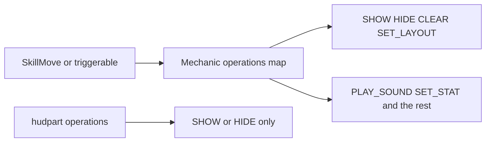

# HUD

The HUD is the text bar above the hotbar. A layout is one arrangement of pieces for a way of playing. Combat shows health, stamina, and belly. A quieter layout shows health only. The player has one active layout. [SET_HUD_LAYOUT](operations/set-hud-layout.md) replaces it, and both rows are never on the bar together. A part is one piece. Appearance is the shared nickname list so a part can say `font: hp` instead of the long pack font id. A skill shows or hides a piece from the same mechanic that plays a sound. The part itself only chooses what a failed requirement does: keep a blank of the same width, or leave the piece out.

## Write these

- [Layout](layout.md) for the `hud_` row and the keys every part shares
- [Appearance](appearance.md) for short font names, the bar letters, and the belly suffixes

## Kinds

- [Glyph](kinds/glyph.md)
- [Bar](kinds/bar.md)
- [Stat](kinds/stat.md)
- [Text](kinds/text.md)
- [Currency](kinds/currency.md)
- [Boolean](kinds/boolean.md)
- [Effect strip](kinds/effect-strip.md)

## Operations

- [SHOW_HUD_PART](operations/show-hud-part.md)
- [HIDE_HUD_PART](operations/hide-hud-part.md)
- [CLEAR_HUD_PARTS](operations/clear-hud-parts.md)
- [SET_HUD_LAYOUT](operations/set-hud-layout.md)

Shake and bleed are `PLAY_EFFECT` with `SCREEN_SHAKE` and `BLOODY_SCREEN`. A full-screen frame, such as a blind or a freeze, is a [glyph](kinds/glyph.md) plus [requirements](../mechanics/requirements.md) and [SHOW_HUD_PART](operations/show-hud-part.md).

## Tips

- Name a layout `hud_` and a part `hudpart_`. Reload lists scripts by that prefix.
- Write `parts:` and `operations:` as numbered maps (`1:`, `2:`).
- Keep every middle slot in the row. When that part is off, draw its pad. Omitting a middle slot slides every later offset. Use a `SHOW_HUD_PART` omit on the last slot, or on an extra that is not in the base row.
