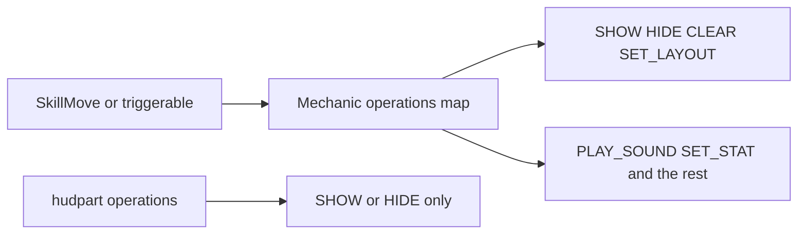

# HUD

A layout is a `hud_` script. It lists the parts that sit on the actionbar, in order. A part is a `hudpart_` script. It is one piece of that bar: a hotbar letter, a health bar, a number, a wallet line, or a row of effect icons.

A skill move, an item skill, a triggerable, or `RUN_MECHANIC` all run a mechanic. A mechanic is a numbered `operations:` map. `SHOW_HUD_PART`, `HIDE_HUD_PART`, `CLEAR_HUD_PARTS`, and `SET_HUD_LAYOUT` are four entries in that same list, beside `PLAY_SOUND` or `SET_STAT`. One skill can show a HUD part and play a sound in the same mechanic.

A `hudpart_` `operations:` list is narrower. It only reads `SHOW_HUD_PART` and `HIDE_HUD_PART`. Those two decide whether a failed requirement omits the part or draws its pad. `PLAY_SOUND` on a part does nothing.

## Write these

- [Layout](layout.md) for the `hud_` row and the keys every part shares
- [Appearance](appearance.md) for short font names, the bar letters, and the belly suffixes

## Kinds

- [Glyph](kinds/glyph.md)
- [Bar](kinds/bar.md)
- [Stat](kinds/stat.md)
- [Text](kinds/text.md)
- [Currency](kinds/currency.md)
- [Boolean](kinds/boolean.md)
- [Effect strip](kinds/effect-strip.md)

## Operations

- [SHOW_HUD_PART](operations/show-hud-part.md)
- [HIDE_HUD_PART](operations/hide-hud-part.md)
- [CLEAR_HUD_PARTS](operations/clear-hud-parts.md)
- [SET_HUD_LAYOUT](operations/set-hud-layout.md)

Shake and bleed are `PLAY_EFFECT` with `SCREEN_SHAKE` and `BLOODY_SCREEN`. A full-screen frame, such as a blind or a freeze, is a [glyph](kinds/glyph.md) plus [requirements](../mechanics/requirements.md) and [SHOW_HUD_PART](operations/show-hud-part.md).

## Tips

- Name a layout `hud_` and a part `hudpart_`. Reload lists scripts by that prefix.
- Write `parts:` and `operations:` as numbered maps (`1:`, `2:`).
- Keep every middle slot in the row. When that part is off, draw its pad. Omitting a middle slot slides every later offset. Use a `SHOW_HUD_PART` omit on the last slot, or on an extra that is not in the base row.
